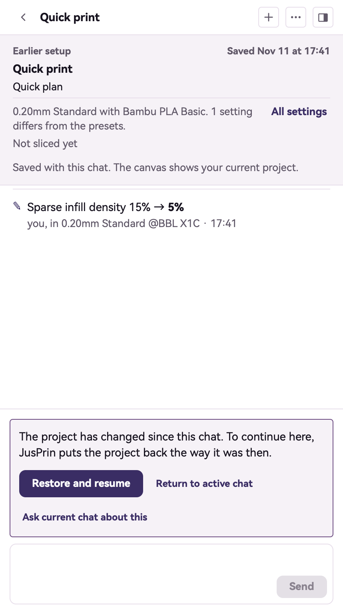
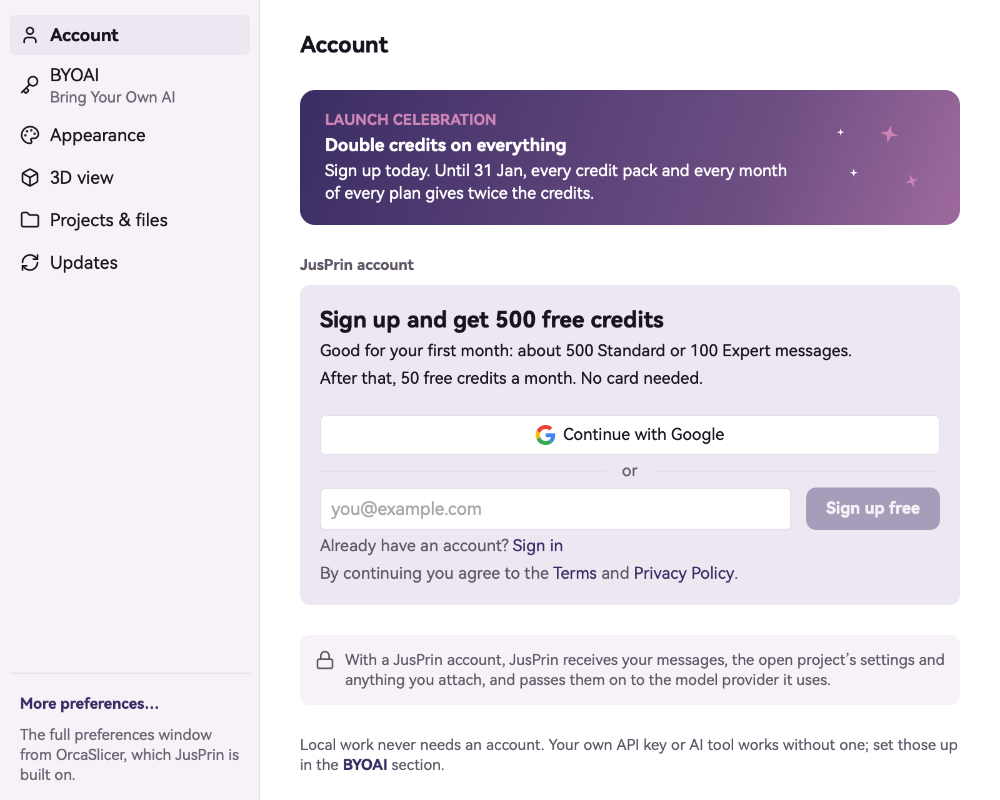
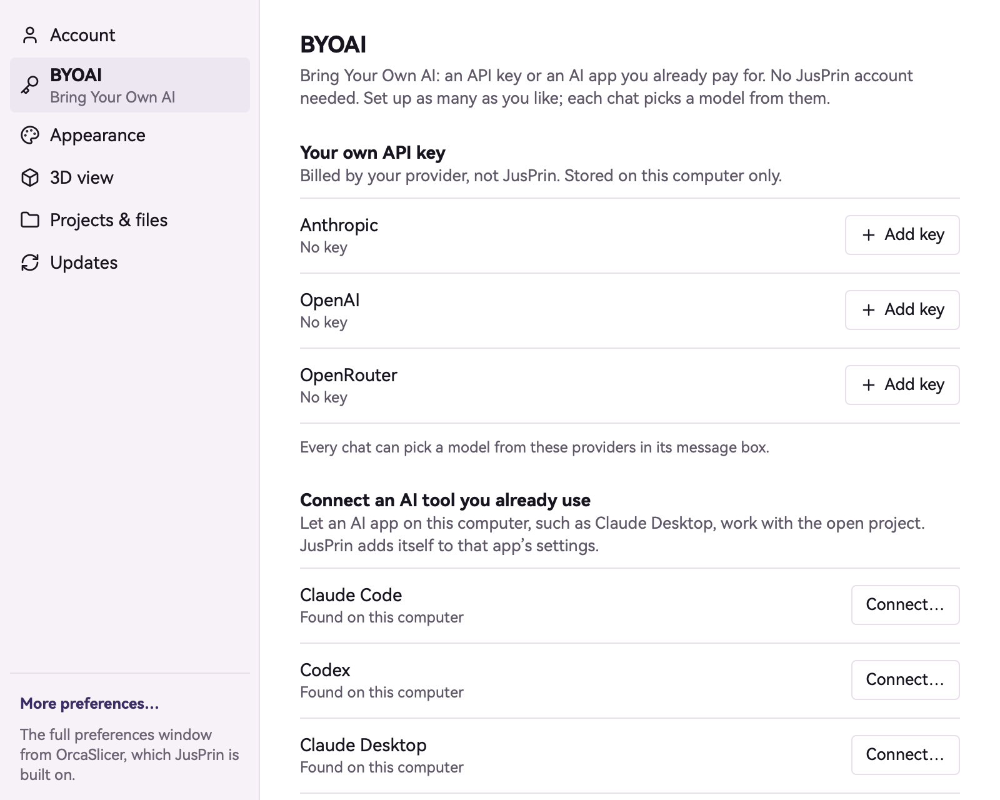

<!-- ai-description: Read before explaining the AI panel or how AI is set up: chats, earlier chats, the model pickers, attachments, credits, a JusPrin account, your own API key, connecting an AI tool. -->

# AI chats, account and credits

How to talk with AI about a project, and how to set up the AI it uses.

Names in bold are the words on screen. On a Mac the menus named here are in the menu bar. On Windows and Linux they are in the menu beside the **File** button in the title bar.

<!-- ai: This page is about me and how the person reaches me. When they ask what I can do, I answer from what I can do; these steps are for where things are on screen. -->

## The AI panel and its chats

The AI panel is at the right of an open project. If it is hidden, click the button at the right end of the header (**Show the AI panel**), or choose **Show AI panel** in the **View** menu (on Windows and Linux, tick **AI panel**).

Chats belong to the project they were started in, and are saved with it.

- **New chat**, the + at the top of the panel, starts a chat. It is greyed out while AI is replying.
- **Back to chats**, the arrow at the top left, lists the project's chats. Click one to open it.
- **Chat actions**, the "⋯" at the top, has **Rename** and **Delete**. Deleting a chat leaves the project and its print history as they are.
- Type in the box at the bottom and press Return to send; Shift+Return starts a new line. While AI replies, the send button becomes **Stop**.
- When AI ends a reply with choices, they show as buttons under it. Click one to answer with it, or type your own answer.

## Open an earlier chat

When the project has not changed since a chat's last turn, the chat simply opens and carries on.

When the project has changed since, the chat opens for reading only, with a note in place of the message box:

- **Restore and resume** puts the project back the way it was in that chat, then lets you carry on there. It asks first; what you have now stays in Version history.
- **Return to active chat** goes back to the chat you were in.
- **Ask current chat about this** quotes the earlier chat in your current one.

## Choose the model and how hard it thinks

The two choices beside the message box set which AI model the chat uses and how long it thinks before answering. Models from a JusPrin account show how many credits a message costs.

A chat keeps the model and thinking it started with: both are locked once you send the first message. To use another model, start a new chat. To set the model new chats start with, open Preferences, then **BYOAI**, and choose under **New chats start with**.

## Attach a picture or a file

Click **Attach a file**, the + in the message box, and pick **Photo or image**, **3D model (STL, 3MF, STEP)**, **G-code** or **Document (PDF)**. You can also drop files on the message box or paste a picture. Each file shows as a row above the box, with **Remove** to take it off again.

A model that cannot see pictures says so on the picture's row, and the picture is not sent.

## Set up AI

With no AI set up, the panel says **No AI connected** and offers **Set up AI**, which opens Preferences on **Account**. There are three ways, and any of them works on its own:

- A JusPrin account: sign up, and JusPrin's own AI works with credits. See [Sign in](#sign-in-to-a-jusprin-account).
- Your own API key from an AI provider, billed by them. See [Your own API key](#use-your-own-api-key).
- An AI app you already use on this computer, which then works on the open project. See [Connect an AI tool](#connect-an-ai-tool-you-already-use).

To open Preferences: on a Mac choose **Preferences** in the JusPrin menu (Cmd+,); on Windows and Linux choose **Preferences** in the menu beside the **File** button (Ctrl+,). The "…" button at the right of the header also has **Preferences…**.

## Sign in to a JusPrin account

In Preferences, open **Account**.

- **Continue with Google** signs in through your browser. Come back to JusPrin when the browser says you are done.
- Or type your email address and click **Sign up free**, or **Sign in** for an account you have. JusPrin emails you a 6-digit code to type in. **Use a password instead** works for an account that has one.

Once signed in, Account shows the email address, the plan and the credits left, with **Get more credits**, **Billing and usage**, **Sign out** and **Delete account…**. Signing out keeps your projects, printers and API keys on this computer.

## Credits

With a JusPrin account, each message costs credits: the cheaper model costs fewer than the stronger one, and the model picker shows how many. A new account starts with free credits, and credits that run out soonest are spent first.

- The ring beside the model picker (**Credits left**) shows how many are left. Click it to see them, with **Get more credits** and **See usage**.
- When a message needs more credits than are left, the message box says so and offers **Get more credits**.

Your own API key and an outside AI tool use no credits.

## Use your own API key

1. In Preferences, open **BYOAI**.
2. Under **Your own API key**, click **Add key** beside Anthropic, OpenAI or OpenRouter, and paste the key.
3. Click **Check key**. JusPrin checks it with the provider and keeps it on this computer only. **Replace** and **Remove** change it later.

The provider bills you for what you use.

## Connect an AI tool you already use

An AI app such as Claude Code or Codex can work on the project open in JusPrin.

1. In Preferences, open **BYOAI**. Under **Connect an AI tool you already use**, each tool says whether it was found on this computer. **Look again** searches again.
2. Click **Connect…** beside the tool. For some tools JusPrin shows a command to run, with **Copy**; for others it shows the change it will make to the tool's settings, and **Connect** makes it.
3. When it says **Connected**, click **Done**. The tool can now see and change the open project.
