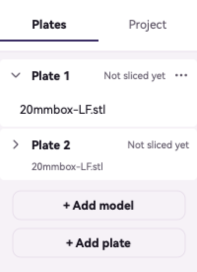
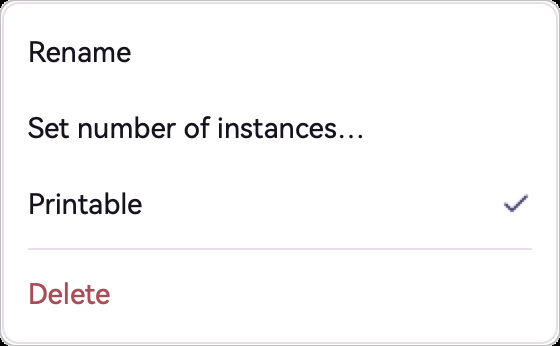
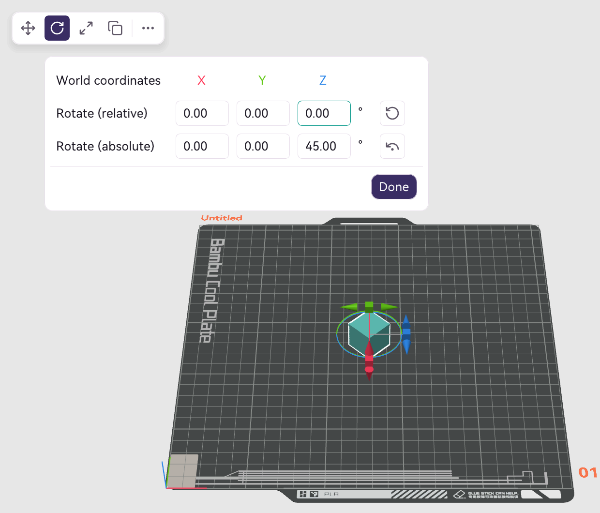

<!-- ai-description: Read before telling the person how to arrange objects on plates by hand: the Plates tab's plate and object menus, Add model, Add plate, Move, Rotate and Scale, and the cut and paint keys. -->

# Plates and objects

How to put models on plates and move, turn, size, copy and split them by hand.

Names in bold are the words on screen. On a Mac the menus named here are in the menu bar. On Windows and Linux they are in the menu beside the **File** button in the title bar.

<!-- ai: These are the by-hand steps. I can import, place, lay out, repair and split objects myself with my tools when the person asks me to; I give these steps when they want to do it themselves or ask where something is. -->

## The Plates tab

The panel at the left of the 3D view lists the project's plates and what is on each. It starts hidden. To show it, click the button at the far left of the header (**Show the Plates and Project panel**), or choose **Show plates and project panel** in the **View** menu (on Windows and Linux, tick **Plates and project panel**). The panel has two tabs; **Plates** is the first.

- Each plate's row says whether it is sliced: **Sliced**, **Not sliced yet** or **Slicing…**.
- Click a plate to make it the plate you are working on. Only that plate is open in the list; a closed plate shows a short summary such as its object's name or how many objects it holds.
- Click an object to select it in the 3D view. Selecting an object in the 3D view selects it here too.
- A row may carry **Mesh needs repair**, **won't print**, the number of its filament, or "×2" and more for copies.
- A diamond mark on a row means the plate or object has settings or painting of its own. On an object, click it to see which; on a plate, it opens the plate's settings.

## A plate's menu

Point at a plate's row and click the "⋯" button at its right, or right-click the row. The menu has:

- **Rename** to name the plate.
- **Arrange** to lay out the objects on this plate only.
- **Auto-orient** to turn this plate's objects to the side that prints best.
- **Lock** to keep this plate's objects where they are. **Unlock** undoes it.
- **Plate settings…** for what can differ per plate, such as its bed type. The guide's page on print settings describes the window.
- **Move to front**, on plates after the first, to make it plate 1.
- **Delete plate**, when the plate can be deleted.

## An object's menu

Point at an object's row and click "⋯", or right-click the row:

- **Rename** to name the object.
- **Set number of instances…** to print several copies of it. Each copy then has a row of its own, with **Delete copy** in its menu.
- **Printable** to leave the object on the plate without printing it. Its row then says **won't print**.
- **Change filament**, when the print uses more than one filament, to print the object in another one.
- **Fix model**, when the model's mesh has errors, to repair it.
- **Split**, when the object is made of separate pieces, then **To objects** to make each separate piece its own object, or **To parts** to keep the pieces as parts of one object.
- **Delete** to take the object off the plate.

## Add a model or a plate

Under the list in the Plates tab:

- **Add model** opens a file and adds its objects to the open project. Dropping a model on the 3D view does the same.
- **Add plate** adds an empty plate. It is greyed out when no more plates can be added.

With nothing in the project, the 3D view says **Drop a model here or add one**.

## Move, rotate and scale an object

Select an object, and a row of buttons appears at the top left of the 3D view: Move, Rotate, Scale, a button that adds a copy, and **More**. The keys M, R and S open the first three as well.

- **Move**: drag the arrows in the 3D view, or type a position under **Position**. **World coordinates** or **Object coordinates** chooses which way the axes point.
- **Rotate**: type an angle under **Rotate (relative)** to turn the object by it, or under **Rotate (absolute)** to set its angle. Press Return to apply what you typed. A reset button beside a row puts the angle back to where it was when the tool opened.
- **Scale**: type a percentage under **Scale** or a size in mm under **Size**. **Uniform scale** keeps the proportions.
- Click the tool's button again, or **Done**, to close it.
- The copy button (**Add instance**) adds one copy of the selected object. Undo takes it away again.

## More: mirror, text and other tools

**More**, the last button in the row, opens the object menu of the 3D view, the same one a right-click on an object opens. It has **Clone**, **Mirror**, the parts and modifiers you can add, including **Text**, and the object's other commands.

Cutting and painting have no button. With an object selected, press a key in the 3D view:

- C to cut the object in two.
- L to paint where supports go, P to paint where seams go, H to paint fuzzy skin.
- F to lay a chosen face flat on the plate.

The other keys of the 3D view are listed under **Keyboard Shortcuts** in the **Help** menu of classic view. JusPrin's own Help menu does not have that item.

Each tool shows its own controls on the 3D view. Press Escape, or the same key, to close it.
