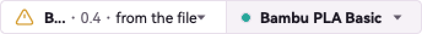
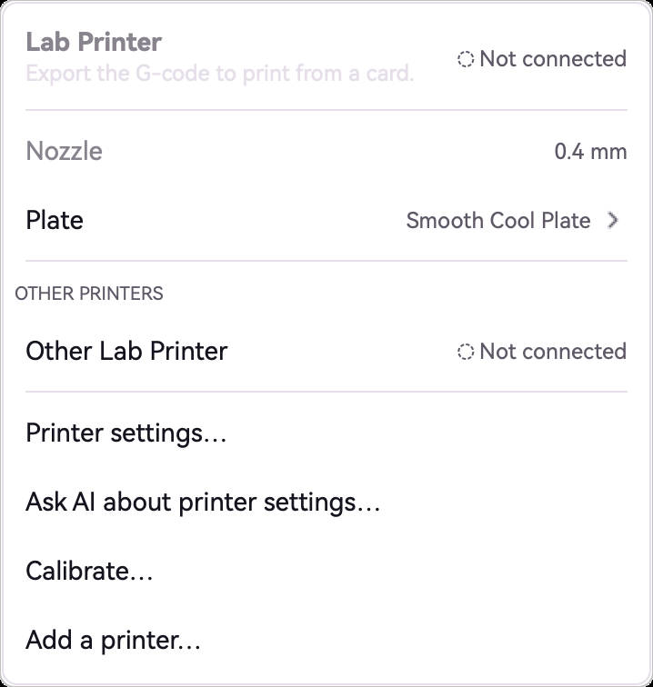
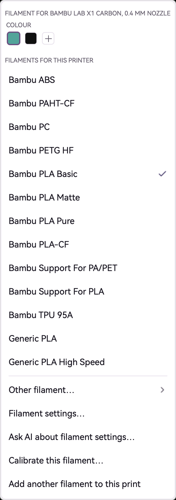
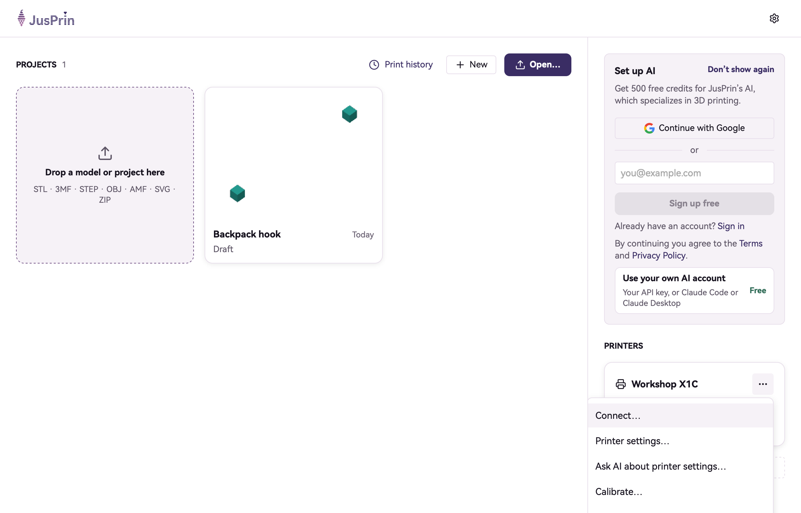
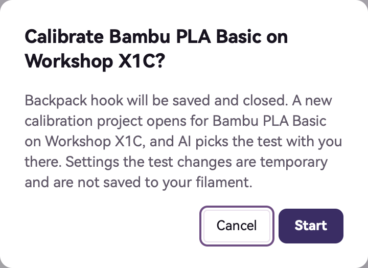

<!-- ai-description: Read before telling the person how to add, connect, rename, remove or switch printers, or pick the plate type, filament or colour by hand: the header, the Printer menu, printer cards, Calibrate. -->

# Printers and filament

How to choose the printer and filament a project prints with, and how to add and manage your printers.

Names in bold are the words on screen. On a Mac the menus named here are in the menu bar. On Windows and Linux the **File** menu is the **File** button in the title bar, and the other menus are in the menu beside it.

<!-- ai: These are the by-hand steps. I can change printer and filament settings myself with my settings tools; adding and connecting a printer happens in the printer's own chat, which these steps open. -->

## The printer and filament in a project

The header of an open project shows the project's printer and its filament side by side, for example "Bambu Lab A1 mini · 0.4" and "PLA". With none chosen they read **Select printer** and **Select filament**. Click either one to open its menu.

The printer's menu has:

- The printer's name and how it is connected, such as **Ready**, **Printing**, **Offline** or **Not connected**. Click it to open the printer's own window.
- **Nozzle**, the nozzle size the project is set up for. It cannot be changed here.
- **Plate**: click it to choose the plate type that is on the printer, such as a textured or a smooth plate.
- **OTHER PRINTERS**: click one to slice the project for that printer instead.
- **Printer settings…**, **Ask AI about printer settings…**, **Calibrate…** and **Add a printer…**.

When a project file brought its own printer, the printer is marked **From the file · not one of your printers**.

## Choose the filament and its colour

Click the filament in the header. The menu has:

- **COLOUR**: click a colour to set the filament's colour. The + after them (**Other colour…**) opens a colour picker.
- **FILAMENTS FOR THIS PRINTER**: click one to print with it, or **Other filament…** to pick from all of them.
- **Use what's loaded on the printer…**, when the printer reports what is loaded in it.
- **Filament settings…**, **Ask AI about filament settings…** and **Calibrate this filament…**.

To print in two or more filaments, click **Add another filament to this print**. The menu then lists each filament by its number; click one to choose its filament and colour. To say which filament an object prints in, use **Change filament** in its menu in the Plates tab.

## The Printer menu

The **Printer** menu has the same commands for the open project: **Add a printer…**, **Printer settings…**, **Ask AI about printer settings…**, **Filament settings…**, **Ask AI about filament settings…** and **Calibrate…**. It works from Home too.

With no printer chosen yet, **Printer settings…** starts adding a printer instead, and **Calibrate…** is greyed out.

## Add a printer

1. On Home, click **+ Add printer** at the top of the printers, or choose **Add a printer…** in the **Printer** menu. A chat titled **Add a printer** opens.
2. Say which printer you have, in your own words, or pick it from a list: **Browse the full printer list** at the top of the chat opens a form that asks **Which printer?** and then **Which plate is on it?**.
3. The printer is saved under its own name and shows on Home. You can add two printers of the same model; each gets a name of its own.

If you skipped choosing a printer the first time JusPrin started, it uses a stand-in, a generic 250 mm Klipper printer, until you add yours.

## Connect a printer

Connecting a printer lets JusPrin send prints to it and show how it is doing. JusPrin connects Bambu Lab printers, and printers that run Klipper with Moonraker or OctoPrint.

1. On Home, click **Connect…** on the printer's card, or open the card's menu (**Printer actions**) and choose **Connect…**.
2. The printer's chat asks for what it needs, such as its address. A Bambu Lab printer also needs its **Access code**, and a print host may need its **API key**. These stay on this computer.
3. **Help me find the code** explains where to find it on the printer.

A Bambu Lab printer needs Bambu's network plug-in. The chat says so when it is missing.

## Rename or remove a printer

Open the printer card's menu on Home (**Printer actions**):

- **Rename**, then type the new name under **Printer name** and click **Save**. A name cannot be empty, hold any of < > [ ] : / \ | ? * ", or be the name of another printer.
- **Remove printer…**, then **Remove**. The printer's own settings are deleted; your projects stay.
- **Printer settings…** and **Ask AI about printer settings…** open its settings.

## Bring printers from another slicer

In the **File** menu choose **Import**, then **Import from JusPrin 1**, or the item above it, which imports from the slicer JusPrin is built on. The printers come with their filaments and print settings, and the other program keeps its own copy. JusPrin offers the same the first time it starts, when it finds them on the computer.

## Calibrate a printer or a filament

Calibration prints a small test, such as a temperature tower, and then sets the printer or filament from what the test shows.

1. Choose **Calibrate…** in the printer's menu, the **Printer** menu or the printer card's menu on Home, or **Calibrate this filament…** in the filament's menu.
2. A question names the printer and filament. Click **Start**. The open project is saved and closed, and the test opens as a project of its own, with a chat that asks which test to print.

Calibration needs AI. When it is not set up, the question offers **Set up AI…** instead of Start.
